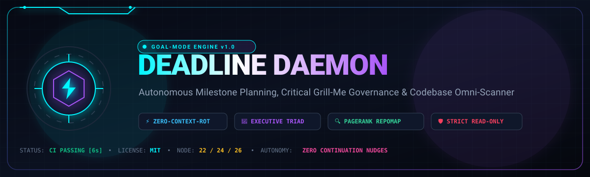
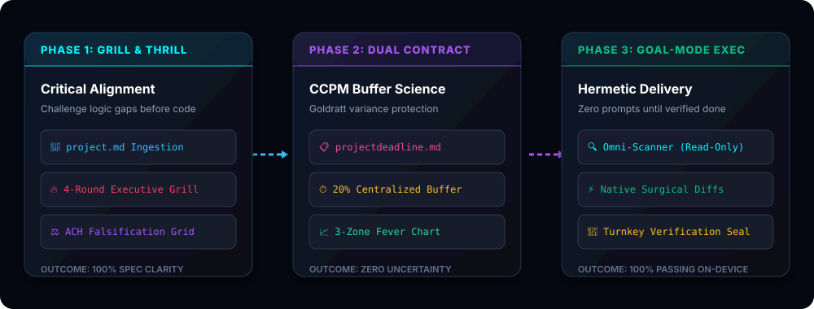

<p align="center">
  
</p>

<p align="center">
  <a href="https://github.com/arvindvincenzo/deadline-daemon/actions/workflows/ci.yml"></a>
  <a href="LICENSE"></a>
  <a href="https://nodejs.org/"></a>
  <a href="#strict-safety-invariants"></a>
  <a href="#the-12-specialized-agent-skills"></a>
</p>

<p align="center">
  <strong>Autonomous Goal-Mode Software Engineering Engine &amp; Forensic Codebase Omni-Scanner</strong>
  <br />
  <em>Stop babysitting AI assistants. Grill requirements upfront, lock mathematical milestone budgets, and execute autonomously to 100% verified completion.</em>
</p>

<p align="center">
  <a href="#quickstart">⚡ Quickstart</a> •
  <a href="#the-four-core-superpowers">🧠 Architecture</a> •
  <a href="#the-12-specialized-agent-skills">🛡️ 12-Skill Matrix</a> •
  <a href="#codebase-omni-scanner-highlights">🔍 Omni-Scanner</a> •
  <a href="#the-7-dimension-nothing-missed-matrix">📋 7-Dim Protocol</a> •
  <a href="docs/GRILL_AND_THRILL.md">🔥 Grill &amp; Thrill</a>
</p>

---

## 🗺️ System Execution Topology

<p align="center">
  
</p>

```
                                ┌──────────────────────────────────────────────┐
                                │               DEADLINE DAEMON                │
                                │        Autonomous Engineering Engine         │
                                └──────────────────────┬───────────────────────┘
                                                       │
                        ┌──────────────────────────────┴──────────────────────────────┐
                        │                                                             │
                        ▼                                                             ▼
        ┌───────────────────────────────┐                             ┌───────────────────────────────┐
        │        DEADLINE METHOD        │                             │     CODEBASE OMNI-SCANNER     │
        │    (Workflow & Governance)    │                             │    (Discovery & Inspection)   │
        ├───────────────────────────────┤                             ├───────────────────────────────┤
        │ • 4-Round Grill ➔ Plan Loop   │                             │ • Multi-Language AST Lexer    │
        │ • 3-Role Review Triad         │                             │ • Personalized PageRank (PPR) │
        │ • 7-Dimension Closure Matrix  │                             │ • Skeleton & Focus Code Folder│
        │ • Goldratt CCPM Buffer Engine │                             │ • FastContext BM25 Localizer  │
        │ • Context-Resilient Memory    │                             │ • Full Typed AST Signatures   │
        │ • Turnkey Verification Seal   │                             │ • STRICT ZERO-WRITE POLICY    │
        └───────────────┬───────────────┘                             └───────────────┬───────────────┘
                        │                                                             │
                        └──────────────────────────────┬──────────────────────────────┘
                                                       │
                                                       ▼
                                      ┌─────────────────────────────────┐
                                      │          NATIVE TOOLS           │
                                      │    (Atomic Authoring & Run)     │
                                      ├─────────────────────────────────┤
                                      │ • read_file / write_file        │
                                      │ • edit_file (Surgical diffs)    │
                                      │ • run_command (Tests, builds)   │
                                      └─────────────────────────────────┘
```

---

## ⚡ The Four Core Superpowers

### 1. 🧠 The "Grill & Thrill" Critical Thinker Loop
Never settle for passive, yes-man prompts. Deadline Daemon interrogates requirements like a Staff Architect:
- **Flaw Mapping**: Proactively simulates single points of failure (SPOFs), race conditions, and unhandled edge cases.
- **ACH Hypothesis Falsification**: Formulates **3 distinct competing designs ($H_1, H_2, H_3$)** and scores them across failure blast radius, testability, and velocity.
- **The 4-Round Gate**: CEO Review (value & cutlines), Staff Eng Review (seams & SPOFs), Design Review (anti-slop UX), and QA Review (concurrency & test commands).
- **Rule**: Grills and refines until **both the prompter and the agent are 100% satisfied** before touching disk.

### 2. ⏱️ Goldratt CCPM & Context-Resilient Memory
Eliminates context rot, hallucinations, and prompt micromanagement:
- **Centralized 20% Project Buffer (PB)**: Individual task estimates are stripped of padding ($P_{50}$ median). Buffer variance is pooled and monitored on a real-time **Fever Chart** (🟢 Green / 🟡 Yellow / 🔴 Red).
- **Durable File-Based State**: Progress is recorded on physical disk (`projectdeadline.md` and `walkthrough.md`). Conversations stay lean; state is never lost.
- **Zero-Nudge Autonomous Execution**: Once approved, the agent self-propels across all milestones without stopping to ask *"Should I continue?"*.

### 3. 🔍 Codebase Omni-Scanner (Node.js Native AST)
Forensic-grade repository comprehension with **zero external dependencies**:
- **Streaming Multi-Language Lexer**: Extracts dense, typed signatures (`func:name(args): ret`) across TypeScript, JavaScript, Python, Go, Rust, Dart, C/C++, Java, and Swift.
- **Personalized PageRank (PPR)**: Multi-graph random-walk biased directly toward query keywords and focus files.
- **Dual-Mode Code Skeletonizer**: Folds function bodies into comments (`/* ... body omitted ... */`), conserving ~85% of LLM context tokens while keeping signatures and JSDoc/rustdoc intact.
- **Sub-2ms Native SQLite Cache**: Uses Node standard library `node:sqlite` (`DatabaseSync`) with SHA-256/mtime gating.

### 4. 🛡️ Hermetic Quality Gate & Runtime Visual QA
- **6-Phase Verification**: Build compilation, type check, linting, unit test coverage, security regex grep, and git diff review.
- **Live Screen Inspection**: Drives Playwright DOM capture or Android ADB (`adb exec-out uiautomator dump`) to guarantee **zero RenderFlex yellow/black hazard stripes**, zero clipped text, and $\ge 48\times 48\text{dp}$ touch targets.

---

## 🚀 Quickstart

### Step 1: Install Skills into Your Agent Environment

Install all 12 specialized skills into your local agent configuration (`~/.gemini/config/skills` or `.agents/skills`):

<table>
<tr>
<th>Windows (PowerShell)</th>
<th>Linux / macOS (Bash)</th>
</tr>
<tr>
<td>

```powershell
npm run install:skills
# or: powershell -ExecutionPolicy Bypass -File .\scripts\install.ps1
```

</td>
<td>

```bash
chmod +x ./scripts/install.sh
./scripts/install.sh
```

</td>
</tr>
</table>

### Step 2: Run Hermetic Quality Gate & Scanner Tests

Validate all 12 skills, templates, and the Codebase Omni-Scanner engine in 1 click:

<table>
<tr>
<th>Windows (PowerShell)</th>
<th>Linux / macOS (Bash)</th>
</tr>
<tr>
<td>

```powershell
npm run verify
# or: powershell -ExecutionPolicy Bypass -File .\scripts\verify.ps1
```

</td>
<td>

```bash
npm test
# or: ./scripts/verify.sh
```

</td>
</tr>
</table>

Output:
```text
=================================================
   Deadline Daemon Verification & Quality Gate   
=================================================
[1/3] Auditing 12 Specialized Agent Skills...
  [+] Skill verified: deadline, wave-planner, runtime-qa, plan-ceo-review...
[2/3] Auditing Templates...
  [+] Template verified: project.md.tmpl, projectdeadline.md.tmpl, walkthrough.md.tmpl
[3/3] Running Codebase Omni-Scanner Tests...
  ✔ CodebaseLexer: TS extraction passed
  ✔ CodebaseLexer: Go method extraction passed
  ✔ SourceSkeletonizer: skeleton and focus modes passed
  ✔ RepoMapBuilder: PageRank multigraph and budget packing passed
  ✔ FastContextLocalizer: term scoring and query ranking passed
  ✔ CodebaseIndexStore: SQLite storage and Levenshtein suggestion passed
  ✔ Strict Read-Only Audit: All 4 tools verified 100% read-only with ZERO write effects
  ✔ CodebaseScannerService: Full end-to-end scanning pass complete

ALL CODEBASE SCANNER TESTS PASSED! 🚀
```

---

## 🛡️ The 12 Specialized Agent Skills

The repository includes a complete executive engineering team packaged as modular agent skills:

| Skill | Directory | Responsibility & Output |
| :--- | :--- | :--- |
| **`deadline`** | [`skills/deadline`](skills/deadline/SKILL.md) | **Grand Orchestrator**: Critical Thinker loop, 4-Round Grill-Me protocol, ACH hypothesis matrix, Goldratt CCPM buffer engine, and zero-nudge autonomous execution. |
| **`wave-planner`** | [`skills/wave-planner`](skills/wave-planner/SKILL.md) | **Execution Planner**: Decomposes complex milestones into atomic, dependency-free parallel waves touching $\le 3$ files each. |
| **`runtime-qa`** | [`skills/runtime-qa`](skills/runtime-qa/SKILL.md) | **Live Ergonomics Auditor**: Drives Playwright or ADB UIAutomator to catch RenderFlex stripes, clipped text ellipsis, and $<48\times 48\text{dp}$ touch violations. |
| **`plan-ceo-review`** | [`skills/plan-ceo-review`](skills/plan-ceo-review/SKILL.md) | **Strategic Gatekeeper**: Protects customer value, tests competitive moats, and locks emergency scope cutlines. |
| **`plan-eng-review`** | [`skills/plan-eng-review`](skills/plan-eng-review/SKILL.md) | **Staff Architect**: Hunts down single points of failure (SPOFs), reviews module depth, and tests failure blast radius. |
| **`plan-design-review`** | [`skills/plan-design-review`](skills/plan-design-review/SKILL.md) | **Design Lead ("Anti-Slop")**: Eliminates UI slop, enforces microcopy truth, and validates all 10 screen lifecycle states. |
| **`verification-loop`** | [`skills/verification-loop`](skills/verification-loop/SKILL.md) | **Hermetic Auditor**: 6-phase test suite scoring (build, typecheck, linter, tests, security grep, git diff review). |
| **`cso`** | [`skills/cso`](skills/cso/SKILL.md) | **Chief Security Officer**: Audits code for OWASP Top 10 vulnerabilities, hardcoded secrets, injection vectors, and broken access controls. |
| **`ship`** | [`skills/ship`](skills/ship/SKILL.md) | **Production Release Engine**: Pre-flight test validation, release manifests, and verified deployments. |
| **`change-impact`** | [`skills/change-impact`](skills/change-impact/SKILL.md) | **Blast Radius Analyzer**: Traces caller trees and affected screens before code is modified to prevent surprise regressions. |
| **`contract-first`** | [`skills/contract-first`](skills/contract-first/SKILL.md) | **Schema Locker**: Validates interface schemas, DTOs, and serialization contracts before business logic is authored. |
| **`database-migrations`**| [`skills/database-migrations`](skills/database-migrations/SKILL.md) | **DB Guardian**: Enforces non-blocking DDL, backward-compatible migrations, and tested rollback scripts. |

---

## 🔍 Codebase Omni-Scanner Highlights

Embedded directly in `packages/scanner`, the scanner delivers sub-second AST comprehension with **zero external dependencies**:

```
[Target Codebase] ──► [Multi-Language AST Lexer] ──► [Def-Use Multigraph]
                                                            │
                            ┌───────────────────────────────┴───────────────────────────────┐
                            ▼                               ▼                               ▼
               [Personalized PageRank]        [Source Code Skeletonizer]              [FastContext BM25]
               Biased by prompt keywords      Folds bodies (saves 85% tokens)         Sub-token identifier match
                            │                               │                               │
                            └───────────────────────────────┼───────────────────────────────┘
                                                            ▼
                                               [Native Node.js SQLite Cache]
                                                    (<2ms Gated Lookups)
```

| Dimension | Traditional Scanners | **Codebase Omni-Scanner** |
| :--- | :--- | :--- |
| **AST Signatures** | Symbol name only (`│func:Run`) | **Full Typed Signatures** (`│func:Run(ctx: Ctx): Promise<Res>`) |
| **Graph Algorithm** | Uniform PageRank (ranks generic utils) | **Personalized PageRank (PPR)** biased by active query |
| **Code Folding** | Indiscriminately strips all comments | **Preserves JSDoc/rustdoc** + dual `skeleton`/`focus` modes |
| **Lexical Search** | Substring / line frequency | **BM25 FastContext** with `camelCase`/`snake_case` sub-tokens |
| **Typo Resilience** | Exact match only | **Levenshtein Distance** suggestions (`suggestSimilarSymbols`) |
| **Caching Engine** | CGO SQLite dependency | **Zero-Dependency Native Node.js** (`node:sqlite`) |
| **Safety Invariant** | Contains file-modifying tools | **Strictly Read-Only Guarantee** (`writesFilesystem: false`) |

---

## 📋 The 7-Dimension "Nothing-Missed" Matrix

Every deadline deliverable is audited against the 7 closure dimensions before release:

```
┌────────────────────────────────────────────────────────────────────────┐
│                   THE 7 CLOSURE DIMENSIONS PROTOCOL                    │
├────────────────────────────────┬───────────────────────────────────────┤
│ 1. Boundaries & Inputs         │ Nulls, empty states, integer overflow │
│ 2. Failure & Recovery          │ 4xx/5xx network drops, offline caching│
│ 3. UI/UX Lifecycle States      │ Loading, Empty, Error, Active, Readonly│
│ 4. Microcopy & Semantics       │ Zero ambiguous errors, CTAs match acts│
│ 5. Concurrency & Debounce      │ Double-tap debounce, 135ms frame gate │
│ 6. Data & Schema Drift         │ Backward-compatible migrations, SQL FK│
│ 7. Hardware & Ergonomics       │ >= 48x48dp touch bounds, 0 leak on exit│
└────────────────────────────────┴───────────────────────────────────────┘
```

---

## 📁 Repository Structure

```
deadline-daemon/
├── .github/
│   └── workflows/
│       └── ci.yml                 # Automated CI pipeline (Node 22/24 runners)
├── assets/
│   ├── banner.svg                 # High-resolution vector header banner
│   └── architecture.svg           # System topology vector graphic
├── docs/
│   ├── ARCHITECTURE.md            # Deep system architecture & invariants
│   ├── GRILL_AND_THRILL.md        # The 4-Round Critical Grill-Me Protocol
│   └── SCANNER.md                 # Omni-Scanner algorithm & API reference
├── packages/
│   └── scanner/                   # Codebase Omni-Scanner Engine (Zero dependencies)
│       ├── src/
│       │   ├── domain/codebase/   # AST Lexer, RepoMap PageRank, Skeletonizer, FastContext
│       │   ├── application/       # SQLite incremental cache, Scanner Service
│       │   ├── contracts/         # Zod-compatible schemas, strict read-only effects
│       │   └── server/            # MCP server dispatcher & tool registration
│       ├── scripts/               # Test runners & ts-loader
│       └── package.json           # Scanner package manifest
├── skills/                        # 12 Specialized Agent Skills
├── templates/
│   ├── project.md.tmpl            # Initial spec template
│   ├── projectdeadline.md.tmpl    # Production deadline tracking contract
│   └── walkthrough.md.tmpl        # Post-deadline delivery & verification seal
├── scripts/
│   ├── install.sh                 # Linux/macOS skills installer
│   ├── install.ps1                # Windows skills installer
│   ├── verify.sh                  # Linux/macOS quality gate runner
│   └── verify.ps1                 # Windows quality gate runner
├── .gitignore                     # Production Git ignore
├── CONTRIBUTING.md                # Community contribution guidelines
├── LICENSE                        # MIT License
├── package.json                   # Root monorepo workspace manifest
└── README.md                      # Project documentation
```

---

## 🔒 Strict Safety Invariants

The scanner operates under a mathematically audited **Read-Only Invariant**:
- **Zero Disk Modification Tools**: The scanner contains no file editing, creating, patching, or deleting capabilities.
- All 4 scanner tools (`scan_codebase`, `search_codebase`, `inspect_codebase`, `trace_codebase`) formally declare:
  ```typescript
  writesFilesystem: false,
  mutatesTarget: false,
  mayDiscardData: false,
  idempotent: true
  ```
- File authoring and modifications remain exclusively governed by native tools (`write_file`, `edit_file`) under the Deadline Method.

---

## 📄 License

Licensed under the [MIT License](LICENSE). Built for high-reliability autonomous engineering.
